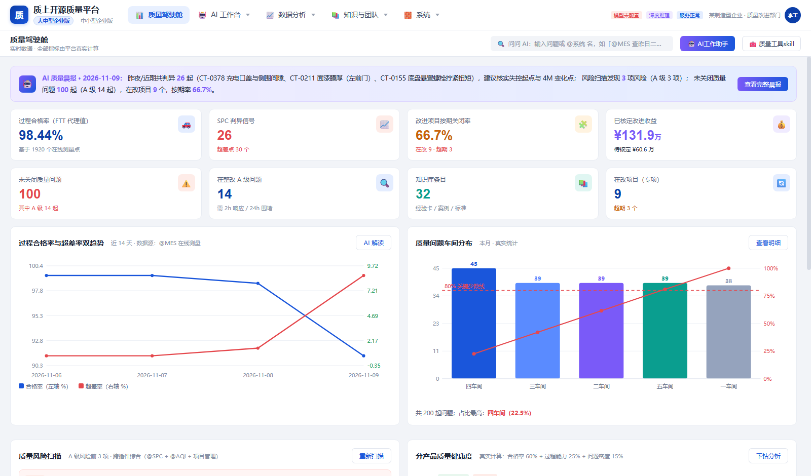
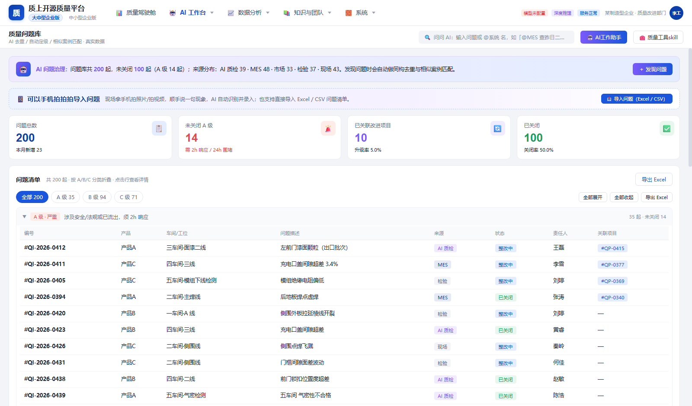

# 质上开源质量平台 · DeepSeek Harness 插件

把一套可运行的本地质量平台，做成 **DeepSeek Harness 里真能用的整页插件**。开源（MIT），可直接私有化部署、二次开发。

## 一键安装并启动

安装 **Node.js 24.9.0 或更新版本**后，在 Windows CMD、PowerShell 或终端运行这一条命令：

```text
npx --yes -p @deepseek-ai/dsh@0.2.2-rc.1 -p pnpm@11 -c "dsh plugin --profile web add https://codeload.github.com/quality-up/dsh-quality-up/tar.gz/refs/heads/main && dsh web --port 0"
```

命令会下载 Harness 和插件，将插件装入本机的 `web` 配置，然后让系统分配一个空闲端口，启动 Harness 并自动打开默认浏览器。进入后，从左侧栏点击 **质上开源质量平台**。配置过公司名称的用户会看到对应的公司名。

首次下载可能需要几分钟。首次使用 AI 时，请按 Harness 页面提示接入 DeepSeek 模型。如果同一配置的 Harness 已在运行，可继续使用原浏览器标签。安装或更新插件后，重启该 Harness 实例即可加载插件。

如果左侧栏已经有 **质上开源质量平台**，日常启动直接运行：

```text
npx --yes @deepseek-ai/dsh@0.2.2-rc.1 web --port 0
```

如果安装时报 `ERR_PNPM_UNEXPECTED_STORE`，看报错中的现有 store 路径。路径末尾是 `v11` 时使用上面的 `pnpm@11`，末尾是 `v10` 时，把一键安装命令中的 `pnpm@11` 换成 `pnpm@10`。使用与现有 Harness 配置匹配的版本即可继续安装。

[更多安装方式](安装说明.md) · [Harness 官方 CLI 参考](https://github.com/deepseek-ai/deepseek-harness/blob/master/apps/cli/reference/README.md)

> **本插件里没有编造的数据、没有预设的话术。**
>
> - 页面上的每个数字都由插件内置的**统计引擎**（SPC 控制图、GB/T 4091 八大判异、Cp/Cpk/Pp/Ppk、t/F/卡方、回归、GR&R、DOE、FMEA-AP、帕累托）对数据库里的测量数据实算；
> - 所有业务数据写入**本机 SQLite 数据库**（`~/.dsh/qip-platform/data/qip.db`），另有 JSON 快照备份；
> - 报告/数据导出是**真正的 .docx / .xlsx 文件**（自研 OOXML 引擎写出，python-docx / openpyxl 可解析），落在 `~/.dsh/qip-platform/data/reports/`；
> - 对话不是关键词匹配：每次推理都通过 Harness 的 `ctx.llm` 调用**当前登录的真实 DeepSeek 模型**（插件默认锁定 `deepseek-official / deepseek-flash`，即 DeepSeek-V4.1-Flash），并由模型真实调用 51 个工具里的 16 个。

---

## 界面预览

以下截图使用平台生成的演示数据。

### 质量驾驶舱



### 质量问题库



---

## 零、开源说明

| 项目 | 说明 |
| --- | --- |
| **许可** | MIT（见 [LICENSE.md](LICENSE.md)）：可商用、可修改、可私有化部署、可再分发 |
| **你要做的** | 保留版权与许可声明；对外分发时随包附带 `LICENSE.md` |
| **不含** | 任何厂商私有数据、客户资料、认证证书文件；初始数据全部是程序生成的合成样例 |
| **数据主权** | 所有数据落在本机 `~/.dsh/qip-platform/data/`，不上传第三方 |
| **模型** | 走 Harness 已登录的 DeepSeek 账号，插件本身不存 API Key |

**参与贡献**：源码就是本目录，没有构建步骤（原生 ESM + 浏览器原生 JS，改完刷新即生效）。

```bash
# 自检：不需要 Harness，直接跑引擎 + SQLite + HTTP
node 自检.cjs        # 或见下文「九、构建 / 维护」里的命令

# 语法检查（改完随手跑）
node --check host.cjs && node --check public/app.js
```

- 提问题/提需求：在本仓库开 issue，写清「页面 + 复现步骤 + 期望」；
- 提 PR：一个 PR 只做一件事，附上 `node --check` 通过说明与截图（UI 改动）；
- 改动数据口径（车间/产品/部门）请走「初始设置」页面，不要直接改 `src/data/seed.js` 里的示例，以免与既有库不一致。

---

## 一、装在哪、怎么打开

| 项目 | 值 |
| --- | --- |
| 插件包 | `dsh-quality-up` v2.0.1（本仓库目录） |
| 安装状态 | 装入 DSH/Reasonix 的 `web` profile 后，**重开应用**生效 |
| 打开方式 | 左侧栏图标（显示名跟随「初始设置 → 公司名称」）→ 主面板整页打开 |
| 页面地址 | `http://127.0.0.1:<Harness 端口>/qip/`（插件 Host 半托管，同源；面板里用 iframe 承载，样式与 Harness 完全隔离） |

左侧栏入口 id 为 `dsh-quality-up`，`order: 7`；主面板 slot 为 `main / dsh-quality-up`。

---

## 二、真数据：数据库与文件都在哪

```
~/.dsh/qip-platform/data/
├── qip.db                     ← 权威数据库（SQLite 3.53，node:sqlite 内置驱动，零第三方依赖）
├── qip-db.json                ← 同一份数据的 JSON 快照（备份/人工核对/迁移用）
└── reports/                   ← 真实生成的 .docx / .xlsx / .csv
```

数据库表结构（关系表 + JSON 文档表混用，兼顾"真数据库"与字段灵活）：

| 表 | 内容 |
| --- | --- |
| `records(collection, id, payload, ...)` | 所有业务集合逐条（问题/项目/知识/QRQC/审批/收益/审计…） |
| `measurements(...)` | 测量值展开成真列（`char_id / ts / value / usl / lsl / shift / batch / vin…`），可直接 SQL 统计 |
| `audit_log(...)` | 每次工具调用 / 人工确认的审计留痕 |
| `reports(...)` | 生成的报告文件登记 |
| `settings(path, value)` / `meta(key, value)` | 设置与平台元信息、计数器 |

- 默认路径可用环境变量 `QIP_DATA_DIR` 覆盖；
- 页内「系统设置 → ④ 数据管理」会显示**数据库绝对路径、大小、各表行数**（来自 `/qip/api/system/db`，不是写死的文案）；
- 首次启动灌入一套**内部自洽**的初始数据（20 问题 / 12 项目 / 7 特性 / 1920 条测量值 / 32 知识 / 180 AI 质检缺陷），测量数据基准日取**灌库当天**，所以"近 7/14/30 日"、趋势图、SLA 计时都对得上今天；
- 页内「重建初始数据」会按当天重新生成；「清空业务数据」只清业务、保留模型配置。导入自己的 Excel/CSV 后即可用真实数据做 SPC/Cpk/报表。

---

## 三、真模型：插件怎么调用 DeepSeek

**不填 API Key、不配置 Base URL。** 插件 Host 半直接复用 Harness 的登录态与模型通道，默认锁定 DeepSeek-V4.1-Flash：

```js
const sel = PREFERRED // { provider: 'deepseek-official', model: 'deepseek-flash' }（= DeepSeek-V4.1-Flash）
const llm = ctx.get('llm')
const call = await llm.prepareCall({ provider: sel.provider, model: sel.model, maxTokens })
for await (const chunk of call.stream({ ...call.config, system, messages })) { /* 真实流式 token */ }
```

- 对话默认锁定 **DeepSeek-V4.1-Flash**（`deepseek-official / deepseek-flash`），可用环境变量 `QIP_LLM_PROVIDER` / `QIP_LLM_MODEL` 覆盖；万一该模型解析不到，自动回落 Harness 当前模型（只回落一次，并打警告）；换账号仍只在 Harness 里改；
- 「系统设置 → ① 模型接入」是只读的真实模型信息 + **测试连通性**（会真的发 2 次请求，4 项自检全绿才通过）；
- 对话内核是 ReAct 工具编排：模型每轮只输出一个 JSON（`{"tool":..., "args":...}` 或 `{"final":...}`），插件执行**真实工具**、把**真实返回**喂回模型，直到给出结论；最多 8 轮，可配；
- 护栏沿用内置实现：结论必须挂出处、对外发送/承诺/8D 关闭三类动作**强制人工确认**（挂起为待确认项，确认后才执行）、VIN/手机号脱敏、全程审计。

实测一次真实对话（浏览器里发的，不是脚本）：

```
用户：CT-0378 近 7 天 SPC 判异命中几条准则？只讲工具返回的事实，并给出控制限。
── 第 1 轮：模型决定调用 spc_rule_check({"charId":"CT-0378","days":7})
── 工具真实执行 1ms → ⚠ 命中 5 条判异准则：准则1、准则5、准则2、准则6、准则4
── 第 2 轮：模型基于返回事实作答（控制限 UCL 3.6788 / CL 3.443 / LCL 3.2071，逐条准则明细）
```

---

## 四、真统计：数字从哪算出来

| 能力 | 实现 |
| --- | --- |
| 控制图 | I-MR / Xbar-R / Xbar-S / EWMA，`3/d2`、`A2/D4` 等常数用未取整精确值 |
| 判异 | GB/T 4091 八大准则逐条判定（CT-0378 实测命中准则 1/2/4/5/6，共 5 条） |
| 过程能力 | Cp/Cpk/Pp/Ppk/Cpm、ppm、西格玛水平（CT-0378 30 天：Cpk 0.887、ppm 4320） |
| 统计检验 | 双样本 t、配对 t、F、卡方、ANOVA、线性/多项式回归、Pearson/Spearman |
| MSA | GR&R（AIAG 公式，EV/AV/GRR/PV/TV、%GRR、ndc）、偏倚、线性、稳定性 |
| 其他 | DOE、FMEA（AP 行动优先级）、帕累托、直方图、分层、质量成本、甘特、趋势预测 |

这些能力同时暴露给 **页面**（工具向导/按钮）、**对话**（AI 工作台）和 **Harness 智能体**（16 个 `qip_*` 工具）。

---

## 五、真文件：报告与导出

- `report_generate`：质量周报 / 月报 / 专项分析 / 根因分析 / 8D / SPC 分析 → 真 `.docx`（标题、KPI 表、过程能力表、问题清单、项目进度、收益台账、结论建议）
- `data_export`：问题库 / 项目 / 测量数据 / SPC / 知识库 / 收益台账 / AI 质检缺陷 / 全部 → 真 `.xlsx` 多工作表（或 CSV）
- 页面里点「生成/导出」→ 返回 `/qip/api/reports/download/<URL编码文件名>` 链接，浏览器直接下载；文件同时留在 `reports/` 目录；
- 第三方校验：生成的 `.docx` 被 **python-docx** 解析（17 段 + 6 张表），`.xlsx` 被 **openpyxl** 解析（7 个工作表，测量数据 1921 行）。

---

## 六、Harness 智能体可用的 16 个真实工具

`qip_overview` · `qip_spc_list_chars` · `qip_spc_rule_check` · `qip_spc_capability` · `qip_spc_control_chart` · `qip_measurements` · `qip_issue_search` · `qip_issue_create` · `qip_project_list` · `qip_project_advance` · `qip_knowledge_search` · `qip_risk_scan` · `qip_benefit_calc` · `qip_report_generate` · `qip_data_export` · `qip_db_status`

在 Harness 对话里直接说「查 CT-0378 的 Cpk」「把本周质量问题导出 Excel」「生成质量月报 Word」即可，工具会真实执行并返回可核验的数值/文件路径。

---

## 七、页面（16 个，全部真实数据渲染）

驾驶舱 · AI 改进工作台 · 质量问题库 · 质量改进项目(8D) · QRQC · SPC 智能判异 · 市场质量与客诉 · 改进收益核算 · 报表中心 · 知识库 · 员工成长 · 审批中心 · 插件架构 · 移动端 · 审计日志 · 系统设置

---

## 八、验证结果（本机实测）

| 验证 | 结果 |
| --- | --- |
| 独立自检 `node tools/selftest.cjs`（内置引擎 + 真 SQLite + HTTP） | **43 / 43 通过** |
| 浏览器验证 `node tools/browser-verify.cjs`（Playwright 真浏览器） | 16/16 页面渲染通过，0 控制台错误，0 请求失败 |
| 页面内 AI 对话 | 真实模型 2 轮推理 + 真实工具调用，作答基于引擎返回事实 |
| 页面内生成并下载 Word | HTTP 200，8175 字节真 .docx |
| Harness 智能体调用 `qip_*` 工具 | 5 个工具全部真实执行（Cpk 0.887 / 5 条准则 / UCL 3.6788 / 真 .docx 落盘） |
| 独立复核控制限 | 从 SQLite 取 300 条测量值手算 `UCL=Xbar+2.66·MRbar` = 3.6788，与引擎一致 |
| 插件重装/重启后数据 | SQLite 中数据与会话保留（持久化验证） |


---

## 九、构建 / 维护

本插件没有构建步骤（原生 ESM + 浏览器原生 JS）。改完代码后：

```bash
# 语法自检
node --check host.cjs && node --check public/app.js

# 引擎自检（不需要 Harness：临时建库 + 跑统计 + 导出文件）
node 自检.cjs
```

改了 **Host 半**（`index.js / host.cjs / agent-host.cjs / llm-bridge.cjs / db.cjs / tools-dsh.cjs / src/**`）需要重装一次插件让它重新加载：
`plugin_manager` → `remove_bundle(dsh-quality-up)` → `install_bundle(<本目录绝对路径>)`。
只改 `public/**`（页面）则刷新页面即可，无需重装。

---

## 十、目录结构

```
dsh-quality-up/
├─ package.json            # 清单：dsh.bundle.patch + dsh.client(web, immediately) + icon + exports
├─ cordis.patch.yml        # 插入 dsh-quality-up 这一行
├─ index.js                # Host 半入口（注册 /qip 路由 + 16 个工具 + 真实模型桥）
├─ host.cjs                # 由内置 server.js 改造：REST/SSE/静态托管，不再自己 listen
├─ agent-host.cjs          # ReAct 内核：每轮走 ctx.llm，真实工具编排 + 护栏
├─ llm-bridge.cjs          # ctx.llm 适配（真实 DeepSeek，无 Key）+ 连通性自检
├─ db.cjs                  # SQLite 持久层（node:sqlite）+ 真列测量值/审计/报告表
├─ tools-dsh.cjs           # 16 个 Harness 工具（复用平台工具实现）
├─ client.js               # Client 半：左侧栏入口 + 主面板 iframe 整页应用
├─ src/**                  # 引擎逐字节移植自同源实现（仅在 store.js 打 SQLite 写穿补丁等 4 处）
├─ public/**               # 前端（仅把 /api/ 改写为 /qip/api/ 等 3 处适配）
├─ locale/zh.json,en.json  # 插件显示名与描述
├─ icon.svg
├─ evidence/               # 验证截图与 JSON
└─ tools/                  # build.py / selftest.cjs / browser-verify.cjs / verify_office.py
```

---

## 十一、已知边界（说清楚，不夸大）

1. **初始数据是给培训/试跑用的**：内部自洽、可被统计引擎检出判异；真实投产请导入自己的 MES 数据（页内支持 Excel/CSV 导入，「首行为表头、自动识别中英文字段」），或接企业系统插件总线。
2. **模型依赖 Harness 账号**：Harness 没有可用模型时，对话会明确报错 `NO_MODEL`，不会编造回复；页面上的统计/报表/数据管理功能不受影响，照常可用。
3. 数据默认只存本机（`~/.dsh/qip-platform/`），单机单用户；多用户/权限继承需要另外接 OA。
4. 报告是 Word/Excel 二进制文件，PDF 需要另用 Office/WPS 另存（未内置 PDF 引擎）。
5. 页面用 iframe 承载（同源），与 Harness 主题相互独立，不跟随深色模式。


